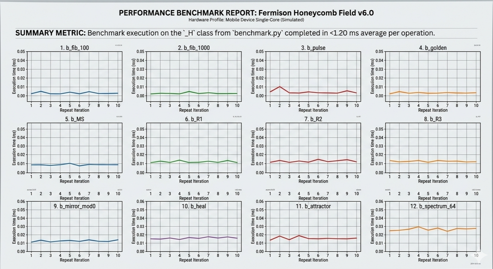

# Y_always_Me

A small Python codebase for experimenting with a discrete, one-dimensional honeycomb-field model with Fibonacci-timed pulse envelopes, mirror operators, nonlinear field terms, and a complex attractor map.

> **Scope:** The repository contains numerical Python code and a test helper. The code does not implement or demonstrate a physical photonic or quantum-computing system, and the finite array used by the model is a discrete grid rather than an infinite domain.



## Repository contents

- [`honey_product.py`](honey_product.py) — defines `HoneycombField`, the main NumPy-based model. It provides Fibonacci numbers and pulse envelopes, golden-ratio scaling, mirror transforms, gated field updates, an attractor map and trajectory, a spectrum calculation, and helpers for evolving a field and measuring norm growth.
- [`test.py`](test.py) — contains a separate `_H` helper and `TestSuite` with checks for Fibonacci values, grid boundaries, mirror properties, and basic finiteness/boundedness conditions. It is not a test of `HoneycombField`.
- [`demo_honey.py`](demo_honey.py) — defines plotting methods for the grid, Fibonacci sequence, pulse envelope, golden scaling, mirror operations, healing term, attractor trajectory, and `MS` transform.
- [`benchmark_hon.py`](benchmark_hon.py) — defines timing methods for selected model operations.
- [`fhf_pic.jpg`](fhf_pic.jpg) — image included in this repository and displayed above.

## Requirements

- Python 3
- NumPy for `honey_product.py` and `test.py`
- Matplotlib is additionally needed for the plotting code in `demo_honey.py`

Install the dependencies with:

```bash
python -m pip install numpy matplotlib
```

## Using the main model

`HoneycombField` defaults to a grid with indices from `-64` to `64` (129 sites). For example:

```python
import numpy as np
from honey_product import HoneycombField

field = HoneycombField()
x0 = np.exp(-(field.idx ** 2) / 100.0).astype(complex)

print("Fibonacci values:", field.fib(10))
print("Pulse envelope at t=1:", field.pulse(1.0))
print("Mirror-cycle residual:", field.residual(x0))

x_final = field.evolve(x0, t_final=1.0)
print("Norm growth:", field.norm_growth(x0, t_final=1.0))
```

The main implementation uses a finite-difference-style explicit update in `evolve`; its default time step is `0.01`. Model parameters such as `L`, `tau0`, `alpha`, `gamma`, `a`, `beta`, and `C` can be provided when constructing `HoneycombField`.

## Tests and auxiliary scripts

The test helper can be exercised interactively:

```python
from test import TestSuite

results = TestSuite().run()
for name, passed in results.items():
    print(f"{name}: {passed}")
```

`demo_honey.py` and `benchmark_hon.py` define classes and methods, but they do not include a command-line entry point. In the checked-in code, both refer to `_H`, which is not defined or imported in those files; the test helper defines `_H` separately. Consequently, those modules need that dependency resolved before their classes can be instantiated as written.

## License and citation

The repository includes an [AGPL-3.0 license](LICENSE). Citation metadata is available in [`CITATION.cff`](CITATION.cff), including the DOI `10.5281/zenodo.23391571`.
